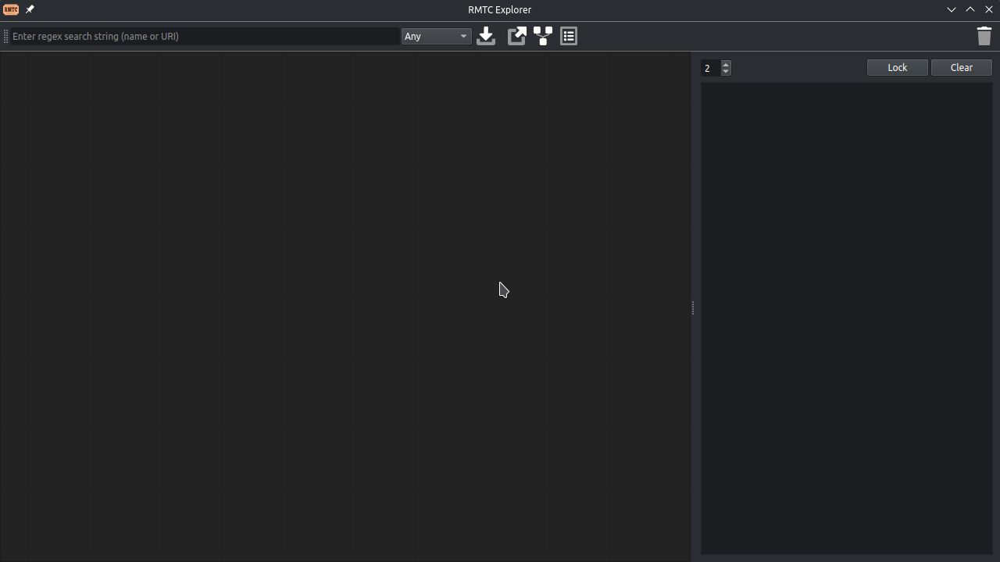

# The Rongotai Model Train Club
RMTC is a VFX industry focused system to track AI artifacts through ingestion, training & inference.

The primary purposes of RMTC is to to provide visibility of where our models and datasets come from when using AI in production pipelines. A secondary goal being to simplify the creation and use of AI models for TDs and artists.

RMTC can be used to ingest foundational models, refine them for specific show needs, publish them to a standard format, invoke them from DCCs and then track the resulting inferred assets back to the models, datasets and associated license information.

RMTC is itself a set of abstractions and minimal shared implementation, however the package provides a core implementation to support PyTorch, AGE and other subsystems. These are only an example - it is straightfoward to create Keras, OpenCue or other abstractions for most parts of the framework. The system has been designed for delegation and abstraction as well as for pick 'n mix applications, for example; if you simply want to instrument your own training pipeline with provenance information, you can with the tracking layer alone. This allows facilities to tailor it to their specific needs. 

Below is an example in the explorer showing the provenance of a fictional DeAge inference, tracing back up the weights, run and input models & datasets.



## The Name
Rongotai is a Te Reo Maori term meaning 'sound of the sea' but is also the name of a Wellington suburb in New Zealand. Weta FX maintains facilities in Rongotai near to where RMTC first came to be. It's a club, since the project was setup with collaboration in mind. No, it's not about model trains, but one of the core features of the framework is about training models.

## License
RMTC is licensed under [Apache-2.0](LICENSE)

RMTC dependencies are licensed under MIT, Modified BSD, BSD-3-Clause, BSD-2-Clause, PSF-2.0 and LGPL-3.0 licenses.

RMTC uses Qt & PySide which fall under a LGPL-v3.0 license with obligations: https://www.qt.io/licensing/open-source-lgpl-obligations.
To obtain PySide, clone https://github.com/pyside to obtain Qt: https://doc.qt.io/qt-6/get-and-install-qt.html

For more detail, see: [Thirdparty Software](THIRD_PARTY.md) & [LGPL-3.0](LGPL-3.0)


## Target Audience
RMTC targets mid to large facilities that use CGI related assets in AI pipelines: VFX houses, videogame studios or synthetic data production. RMTC assumes it will be used in tandem with scaled infrastructure for staorage and compute.

## Project Status
It is possible to use the system for tracking, training and inference of Torch models, however expect significant changes as this is still under active development.

This project is in ASWF Sandbox prototyping stage and has yet to be tested through production. We are maintaining a dev branch and looking to migrate once a production test has been completed.

## Installation
RMTC targets facility level institutions with their own asset, package and renderwall infrastructures. We understand that you might have a complex package management setup and as a result - we defer the dependencies installation to the institution. 

The default RMTC Core System by default requires a Tensorboard service and an Apache AGE instance to operate - you'll need the url, port, credentials and name - these go into the config file discussed later.

For example to kick off AGE under docker it might look like the following:
```bash
docker run -it --rm \
    --name age \
    -p 5432:5432 \
    -e POSTGRES_USER=postgres \
    -e POSTGRES_PASSWORD=postgres \
    -e POSTGRES_DB=postgresDB \
    apache/age
```

To install, we have a very simple cmake arrangement, with a root CMakeLists.txt that defers to a cmake subfolder with it's own CMakeLists.txt. The root CMakeLists.txt file exists for convienience & expectations, but the intent is that we separate src & build information - since facilities may use entirely custom build setups we avoid interleaving a specific build paradigm.

Assuming you are in your development folder, you can run the following to get going:

```bash
git clone https://github.com/AcademySoftwareFoundation/rmtc.git
cd rmtc
cmake -DCMAKE_INSTALL_PREFIX=$HOME/.local -B cmake/build -S .
cd cmake/build
make install
source ./rmtc-setup.bash
cd -
```

_Note_: You can replace `$HOME/.local` in the cmake command above with your installation directory of choice.

This will clone the repo into your code folder, create build info in cmake/build, then copy the Python source, binaries and resources into a given install path. The final shell script source sets up the envvars required to execute. This does not install the third party dependencies listed in [pyproject.toml](pyproject.toml) - see [Dependencies](#dependencies) below for that step.

However, before running, you will need to create a config file for your age installation derived from one of the [example configs](res/config), the RMTC_CONFIG_NAME environment variable points RMTC to the config to use, which you can override as follows:

```bash
# csh / tcsh
setenv RMTC_CONFIG_NAME <config_name>

# sh / bash / zsh
export RMTC_CONFIG_NAME=<config_name>
```

You also need to set `RMTC_MODULES` environment variable to the directory containing the module registry YAML files. A common choice is `./res/modules/`.

The environment variable `RMTC_RESOURCES` points to the resource directory, commonly used for test fixtures. A common choice is `./res`

To test simply call `rmtcgui` which should bring up the ingestion, train, track & trace UI. This will be empty at first.

You can also run `pytest` from the root of the project to run the unit tests and integration tests.

## Setting Up
See [pyproject](pyproject.toml) for a list of dependencies in machine readible format - these are not configured, found or installed as part of the build currently.

You can run from the root:

```bash
pip install .
```

## Configuration
You will need an AGE instance running. Store connection credentials are supplied via environment variables rather than the config file (see below).

The below is the minimum config required for a AGE/Tensorboard setup, see the [example configs](res/config) for full reference:

```yaml
rmtc_store:
  type_name:    rmtc_core.Store.AGE-1.0.0
  name:         rmtc            #the graph name
  uri:          postgres:<uri>  #the age instance URI

rmtc_tracker:
  type_name:    rmtc_core.Tracker.TensorBoard-1.0.0
  uri:          <tensorboard run path>
```

`type_name` is required on any subsystem entry - it is resolved to a concrete class via the Factory, see [technical notes](docs/technical/README.md) for how this works. Any items added in here are accessible in Python via the internal Config class dict.

RMTC_USER and RMTC_PW environment variables supply the store connection credentials - these are not part of the config file:

```bash
export RMTC_USER=<username>
export RMTC_PW=<password>
```

## Usage
To get going you can run the MNIST training example which will download the MNIST dataset, convert to EXRs and CSV data, run local training, then run an inference, all the while creating the database tracked objects. Once trained you can invoke the explorer and click through the provenance tree.

* `python <repo>/examples/mnist/example_00_export_exrs.py --input=<mnist data> --output=<exr output>`
* `python <repo>/examples/mnist/example_01_train_infer.py --solution_path=<solution dir> --mnist_path=<exr output> --results_path=<results dir>`
* `rmtcexplorer --config=demo`

## Examples
Further worked examples, each with their own README, can be found under [examples](examples):

* [Basics](examples/basics) - simple getting going examples for system setup, basic object creation and general usage
* [Image2Mask](examples/image2mask) - train an image-to-mask model and track the model, dataset and run
* [MNIST](examples/mnist) - full worked example categorising the public MNIST dataset
* [Tracking](examples/tracking) - lower-level DB tracking calls, useful for instrumenting your own pipelines
* [Pipeline](examples/pipeline) - build artifact variants with the asset manager pipeline builders and publish them

## Web UI and Server

Optionally, you can spin up a REST server and a Web UI to query and browse entities in the database.

The REST server has its own `pyproject.toml` file, so you can install its dependencies after `pip install .` to run it in a separate terminal:

```bash
pip install ./src/python/server
gunicorn --workers 2 --bind 127.0.0.1:9000 "rmtc_server.app:create_app()"
```

You should see `[INFO] Listening at: http://127.0.0.1:9000 (<pid>)`

The server uses the same environment variables and config as [Configuration](#configuration)

To populate the database so that there is something for the server to serve, you can run one of the examples - [this one, for instance](examples/basics/example_01_simple.py). 
Since the examples use a demo config by default, you will want to remove this line so that it uses your `RMTC_CONFIG_NAME` environment variable instead:
```python
rmtc_sys            = System(
    config          = Config(), #removed name=demo
)
```

The Web UI runs on Node JS (>= 22). You can set up a development server using `npm` in another separate terminal:

```bash
cd ./src/web/browser
npm ci
npm run dev
```

You should see `Local: http://localhost:5173/`

After populating the database, you can search for `Test` and the entities from the example should show up.

For more details, see [server docs](docs/technical/server.md) and [webui docs](docs/technical/webui.md)

## Code Structure

The rmtc module provides abstractions and system objects, with rmtc.core providing the basic implementation. There is some functionality within rmtc, but without core it doesn't do a lot. We generally follow PEP8 style, with a lean towards verbosity for the sake of comprehension to an engineer less familiar with Python. We use abstract interfaces and injection with strong typing in the property system - but stopping short of true python type checking. Methods take arrays where possible - to provide allowance for batch optimisations later.

Regarding package names - we use the following structure:
`rmtc.<module>.<subsystem>.<component>[.<technology>].<file>`
* module - the root module - `core` is the reference implementation shipped with RMTC; a facility can add its own (e.g. `weta`) following the same layout
* subsystem - the top level functional area within the module - `ops`, `track`, `system` or `interface`
* component - the specific area within that subsystem - e.g. `artifacts`, `io`, `pipeline`, `process`, `train`, `infer`, `scheduling` under `ops`; `entities`, `store`, `filters`, `publishing`, `tracing` under `track`; `environment`, `objects`, `serializers` under `system`; `rest` under `interface`
* technology - the system or tech satisfying the component, omitted where there's only one implementation - `oiio`, `torch`, `onnx`, `cypher`, `nuke`, `safetensors`
* file - the file grouping the class(es) - `model`, `dataset`, `builders`

For example:
* `rmtc.core.ops.io.oiio.image`
* `rmtc.core.ops.artifacts.torch.models`
* `rmtc.core.track.store.cypher.neo4j`

Note that base types like `Logger` and `Config` live directly in `rmtc.system`, not `rmtc.core.system` - the latter only holds concrete technology implementations (environment, objects, serializers). The `Interface`, `Client` and `Server` base classes live in `rmtc.interface`, with the concrete REST client in `rmtc.core.interface.rest`.

For further information see the [technical notes](docs/technical/README.md) documentation.

## Support
As this is a Linux Foundation / ASWF project we benefit from the ASWF infrastructure. Please reach out on slack to talk through issues you might face.
* [Issues](https://github.com/AcademySoftwareFoundation/rmtc/issues)
* [Slack](https://academysoftwarefdn.slack.com/archives/C09FP5KUUP4)
* [Wiki](https://lf-aswf.atlassian.net/wiki)

## Contributing
Details for contributing can be found [here](CONTRIBUTING.md).

## Initial contributors and acknowledgments
* John McCarten
* Eric Hayes
* Vincent Wang
* Stephen Revel
* Troy Tobin
* Jonathan Swartz
* Juan Buhler
* Andy Wright
* Kimball Thurston
* Masahiro Teraoka
* Niall Lenihan
* John Mertic

## Dependencies

| Name | Version |
|------|---------|
| Python | 3.9.18 |
| Python Standard Library | 3.9.18 |
| Packaging | 25.0 |
| Yaml | 6.0.1 |
| Numpy | 1.23.0 |
| OpenImageIO | 2.2.16.0 |
| Flask | 3.1.0 |
| Requests | 2.28.0 |
| PyTorch | 2.1.0 |
| OpenCV | 4.8.0 |
| TorchVision | 0.16.0 |
| Tensorboard | 2.19.0 |
| ONNX | 1.16.0 |
| ONNX Runtime | 1.19.2 |
| ONNX Script | 0.2.0 |
| Neo4j Driver | 4.4.10 |
| Apache AGE Driver | 0.0.7 |
| NodeGraphQt | 0.6.38 |
| PySide | 5.15.2 |
| Qt | 5.15.2 |
| Nuke | 13.1 |

See: [Thirdparty Software](THIRD_PARTY.md)

---
<center>SPDX-License-Identifier: Apache-2.0 | Copyright Contributors to the RMTC Project</center>